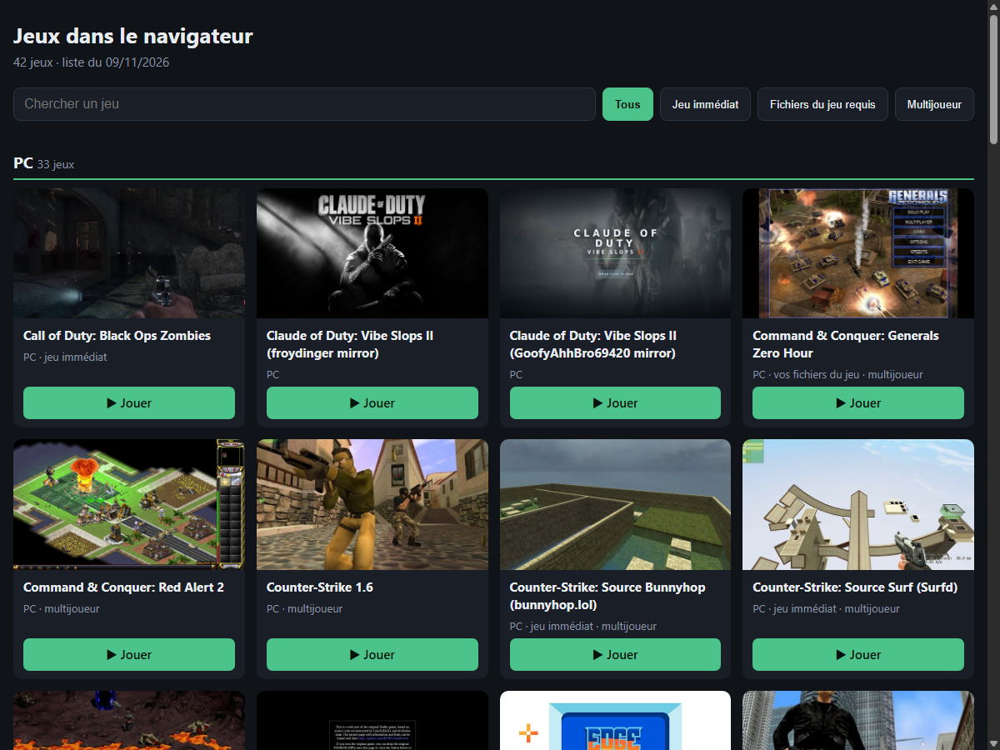
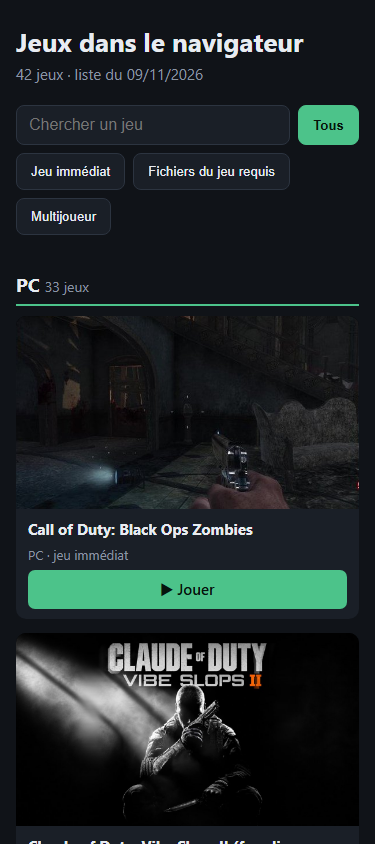

# 🎮 Jeux dans le navigateur

**Des jeux PC et console connus, jouables directement dans le navigateur, sans rien installer.**

👉 **Ouvrir la page : https://jerome622.github.io/JeuxNavigateur-vitrine/**

  
  &nbsp;&nbsp;
  

---

## ✨ Ce que fait la page

| | |
|---|---|
| 🗂️ **Rangée par plateforme** | Une section par machine : PC, PS2, Xbox, PS1, N64, NES… La plus fournie en premier. |
| 🔎 **Recherche** | On tape une partie du nom et la liste se réduit tout de suite. |
| ⚡ **Jeu immédiat** | Seulement les jeux qui se lancent tout de suite, sans fichier à fournir (et les démos gratuites). |
| 💾 **Fichiers du jeu requis** | Les jeux qui demandent les fichiers de votre propre copie du jeu. |
| 👥 **Multijoueur** | Seulement les jeux où l'on joue à plusieurs en ligne. |
| ▶️ **Jouer** | Le bouton ouvre le jeu dans un nouvel onglet. |
| 🔄 **Toujours à jour** | À chaque ouverture, la page lit la dernière version de la liste. Pas de serveur, rien à mettre à jour à la main. |
| 📱 **Partout** | Ordinateur, tablette et téléphone. |
| 🚫 **Sans publicité** | Pas de pub, pas de fenêtre qui s'ouvre toute seule, pas de compte. |

---

## ❓ Comment ça marche

1. La page télécharge la liste publique **[awesome-decomp-games](https://github.com/SubmitGame/awesome-decomp-games)**.
   Des bénévoles y recensent des jeux recréés pour le navigateur, et chaque lien y est vérifié tous les jours.
2. Elle ne garde que les jeux **jouables dans le navigateur** dont le lien **marche** aujourd'hui.
3. Elle les range par plateforme, avec l'image du jeu et ses étiquettes (jeu immédiat, vos fichiers, multijoueur).

## 💾 « Fichiers du jeu requis », ça veut dire quoi ?

Certains jeux sont des versions refaites pour le navigateur, mais sans les images, les sons ou les niveaux d'origine.
Le site vous demande alors les fichiers de **votre propre copie** du jeu, achetée légalement.
Cette page ne fournit et n'héberge aucun fichier de jeu.

## ⚠️ À savoir

- Les jeux sont sur les **sites d'autres personnes**. Leur sécurité et leurs droits ne sont pas vérifiés ici.
- **N'installez jamais** un logiciel, un « lanceur » ou une extension qu'un site de jeu vous demande d'installer.
- Il faut une connexion Internet. Certains jeux sont lourds et mettent un moment à charger.

---

Liste des jeux : <a href="https://github.com/SubmitGame/awesome-decomp-games">SubmitGame/awesome-decomp-games</a>. Les noms et images des jeux appartiennent à leurs propriétaires.
